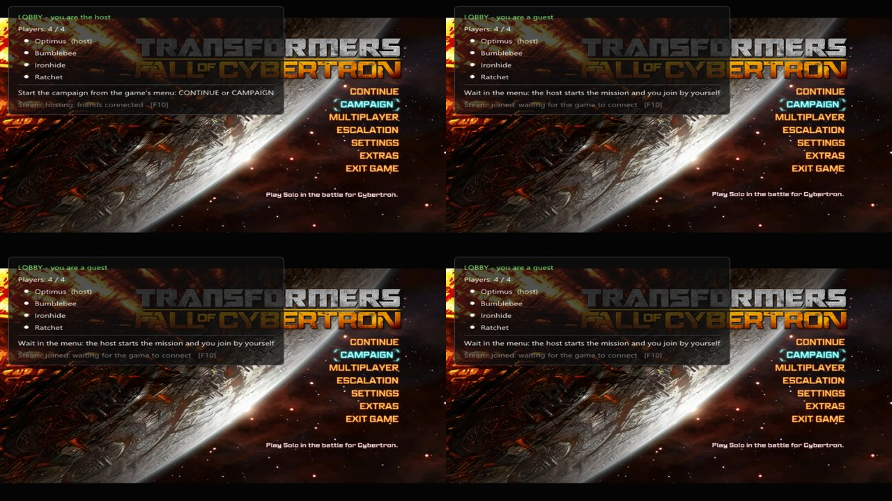
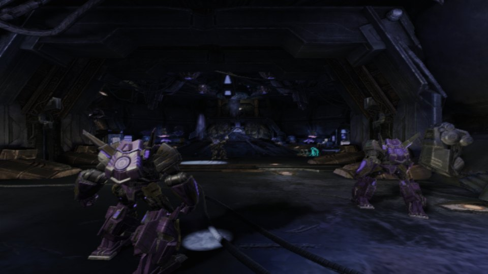

# Fall of Cybertron Co-op

**Play the Transformers: Fall of Cybertron campaign together with your friends — up to 5 players, over Steam.**

English | [Русский](README.ru.md)

## What it does

- **Co-op campaign for up to 5 players.** One player hosts, friends join, and you go through the story together.
- **Everything goes through Steam.** No IP addresses, no port forwarding: friends find your game in the in-game menu.
- **Same world for everyone.** Enemies, damage and story events are shared; cutscenes play for everybody at the same
  time, and after a scene the whole team continues together.
- **Help each other.** A downed player can be revived by a friend.
- **In-game co-op menu on F10** — create a lobby, join a friend, change settings. English and Russian.
- **Russian language** for the whole game (optional, built into the installer).
- **Borderless window.** Choose windowed mode in the game's settings and it fills the screen without a frame —
  Alt+Tab is instant.
- **Extra mods in one click.** The installer downloads and installs them for you, with a progress bar:
  - High Quality Audio Logs
  - FMV Remaster (cutscene videos in high quality)
  - Authentic High-Quality Textures (textures from the PS4 version; installing takes 5-10 minutes)
  - Skip the intro videos
  - Advanced Configurator (F1 menu: FPS, field of view, graphics) — set up for 200 FPS and high quality
  - ReShade with a light sharpening preset (Home opens its menu)

## Install

1. Download **`FoCCoopSetup.exe`** from [Releases](https://github.com/Nazarik322/foc-coop/releases).
2. Run it. The game folder is found automatically.
3. Tick the extra mods you want (sizes are shown next to them) and press **Install**.

To remove the mod, run the installer again and tick "Remove the mod". Every game file a mod replaces is backed up and
put back.

**You need:** Transformers: Fall of Cybertron on Steam, Steam running, and your friends in your Steam friends list.
Every player needs their own copy of the game and this mod.

## Play with friends

| | |
|---|---|
|  |  |
| **Host:** press **F10** → Host a game → **Create lobby**. | **Friends:** press **F10** → Join a game → **Join lobby**. |

When everybody is in the lobby, the host starts the campaign from the game's own menu — **Continue** or **Campaign** —
and all friends are taken into the mission automatically.

## Good to know

- While the mod is installed, Steam shows the game as "Spacewar" — this is the free Steam app the co-op connection uses.
- All players should pick the same extra mods.

## Credits

Extra mods by their authors on [Nexus Mods](https://www.nexusmods.com/transformersfallofcybertron): High Quality Audio
Logs, FMV Remaster, Authentic High-Quality Textures, No-Intro Splash Fix, TFOC Advanced Configurator; TFC Installer
(UPK Explorer) applies the texture pack. Russian translation by Zerberus
([Steam guide](https://steamcommunity.com/sharedfiles/filedetails/?id=2983257437)). [ReShade](https://reshade.me) by
crosire, colour preset by fpc.

Unofficial fan project, not affiliated with Hasbro, High Moon Studios or Activision. No game files are included.
For developers: [docs/dev](docs/dev/README.md).
