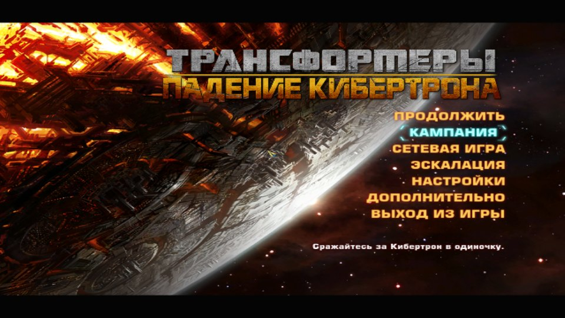
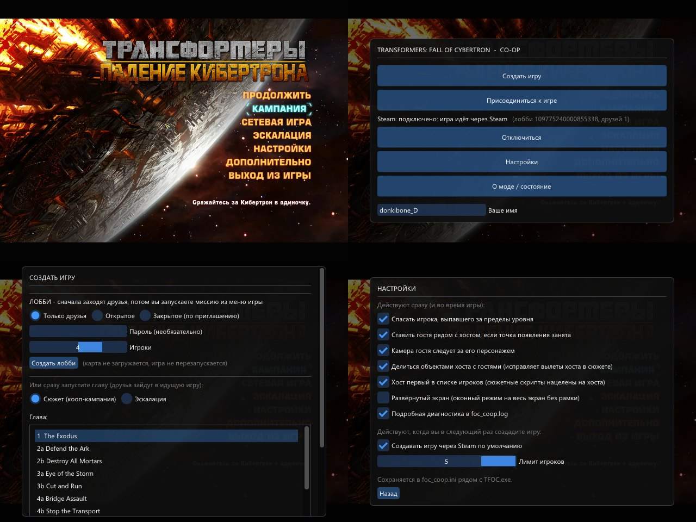
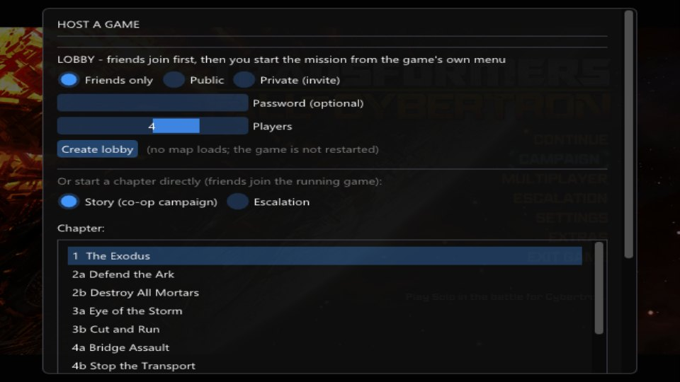
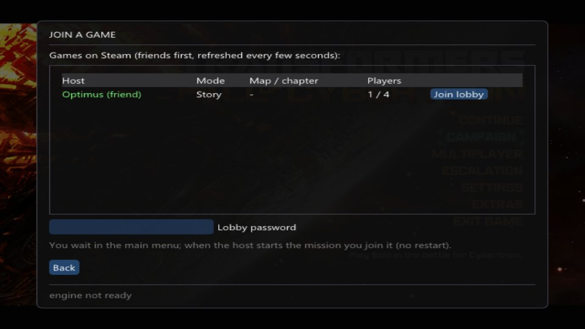
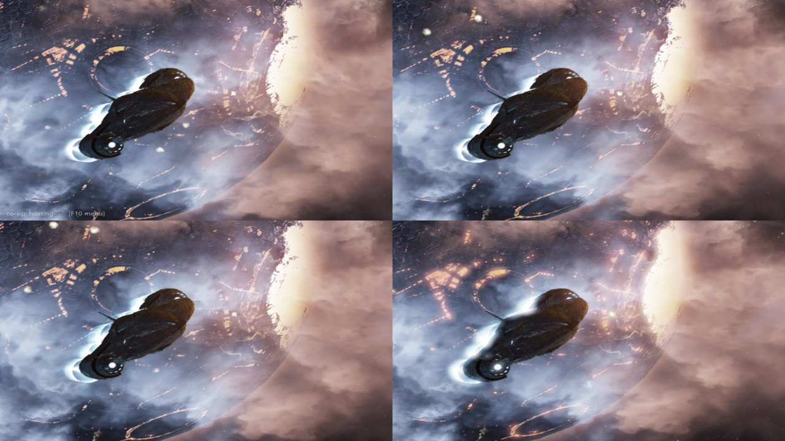
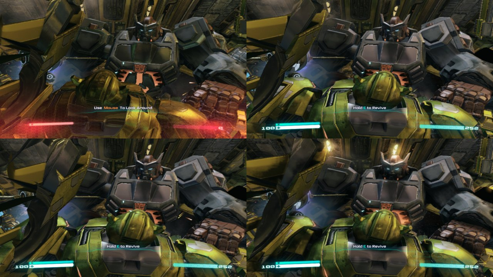

# Кооператив для Fall of Cybertron

**Проходите кампанию Transformers: Fall of Cybertron вместе с друзьями — до 5 игроков, через Steam.**

[English](README.md) | Русский

## Что умеет мод

- **Кооперативная кампания до 5 игроков.** Один создаёт игру, друзья заходят — и вы проходите сюжет вместе.
- **Всё через Steam.** Без IP-адресов и проброса портов: друзья видят вашу игру прямо в меню.
- **Один мир на всех.** Враги, урон и сюжетные события общие; ролики показываются всем одновременно, а после сцены
  вся команда продолжает вместе.
- **Помогайте друг другу.** Упавшего игрока может поднять друг.
- **Меню кооператива на F10** — создать лобби, зайти к другу, настройки. На русском и английском.
- **Русский язык** для всей игры (по желанию, встроен в установщик).
- **Развёрнутый экран.** Выберите в настройках игры оконный режим — окно займёт весь экран без рамки, и Alt+Tab
  срабатывает мгновенно.
- **Дополнительные моды в один клик.** Установщик сам скачает и установит их, с полоской загрузки:
  - Аудиологи в высоком качестве
  - Ремастер видеороликов
  - Текстуры высокого качества (из версии для PS4; установка занимает 5-10 минут)
  - Пропуск вступительных роликов
  - Advanced Configurator (меню F1: FPS, угол обзора, графика) — уже настроен на 200 FPS и высокое качество
  - ReShade с лёгким пресетом резкости (Home — меню ReShade)

## Установка

1. Скачайте **`FoCCoopSetup.exe`** в разделе [Releases](https://github.com/Nazarik322/foc-coop/releases).
2. Запустите его. Папка с игрой найдётся сама.
3. Отметьте нужные дополнительные моды (рядом показан размер) и нажмите **«Установить»**.

Чтобы удалить мод, запустите установщик ещё раз и отметьте «Удалить мод». Все файлы игры, которые заменяют моды,
сохраняются и возвращаются на место.

**Нужно:** Transformers: Fall of Cybertron в Steam, запущенный Steam и друзья в списке друзей Steam.
Каждому игроку нужна своя копия игры и этот мод.

## Игра с друзьями

| | |
|---|---|
|  |  |
| **Хост:** нажмите **F10** → Создать игру → **Создать лобби**. | **Друзья:** нажмите **F10** → Присоединиться к игре → **Войти в лобби**. |

Когда все в лобби, хост запускает кампанию из обычного меню игры — **«Продолжить»** или **«Кампания»**, — и друзья
сами попадают в миссию.

## Полезно знать

- Пока мод установлен, Steam показывает игру как «Spacewar» — это бесплатное приложение Steam, через которое идёт
  кооперативное соединение.
- Всем игрокам лучше выбрать одинаковые дополнительные моды.

## Благодарности

Дополнительные моды — их авторам на [Nexus Mods](https://www.nexusmods.com/transformersfallofcybertron): High Quality
Audio Logs, FMV Remaster, Authentic High-Quality Textures, No-Intro Splash Fix, TFOC Advanced Configurator; текстуры
ставит TFC Installer (UPK Explorer). Русификатор — Zerberus
([руководство в Steam](https://steamcommunity.com/sharedfiles/filedetails/?id=2983257437)). [ReShade](https://reshade.me) —
crosire, цветовой пресет — fpc.

Неофициальный фанатский проект, не связан с Hasbro, High Moon Studios и Activision. Файлы игры не включены.
Для разработчиков: [docs/dev](docs/dev/README.md).
